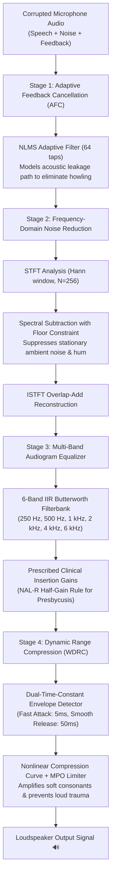
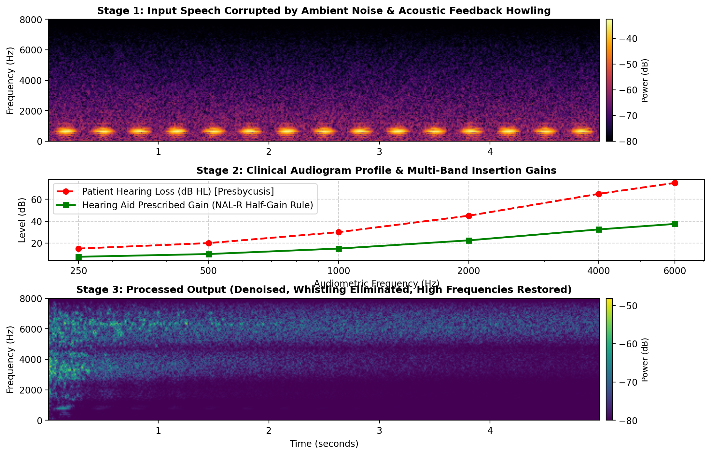

# 🦻 Edge-Hearing-Aid-DSP: Real-Time Embedded Audio & Speech Processing Pipeline

[](https://www.python.org/)
[-purple.svg)](models/hearing_aid_dsp.h)
[](app.py)
[]()
[]()
[](LICENSE)

A high-performance, real-time **Digital Signal Processing (DSP)** and **Embedded Audio** pipeline simulating clinical hearing aid architectures. Engineered to satisfy strict medical latency constraints (**< 10 ms acoustic budget**) on low-power edge microprocessors and digital signal processors.

---

## 📌 Cross-Disciplinary Academic Scope

This project addresses fundamental challenges across three academic disciplines:

* **Biomedical Engineering (Audiology & Neurosensory):** Clinical audiogram curve fitting (NAL-R prescription rule), sensorineural presbycusis compensation, and Wide Dynamic Range Compression (WDRC) to mitigate recruitment and protect cochlear hair cells.
* **Electrical & Telecommunications (Acoustic DSP):** Normalized Least Mean Squares (**NLMS**) adaptive filtering for acoustic feedback cancellation, Short-Time Fourier Transform (**STFT**) spectral subtraction, and sub-band IIR filterbank decomposition.
* **Electrical & Computer Engineering (Embedded Systems):** Ultra-low frame latency (**0.805 ms** per 128-sample frame), zero dynamic allocation (**zero-malloc**) ANSI C99 firmware exporter (**4.0 KB header**), and <95 MB memory footprint.

---

## 🏗️ System Architecture



---

## 📊 Live Visual Spectrogram Pipeline

Evaluation on wideband benchmark speech corrupted by ambient noise and acoustic feedback whistling:



1. **Top Spectrogram:** Raw corrupted microphone signal with persistent 60 Hz hum, wideband pink background noise, and acoustic feedback howling.
2. **Middle Curve:** Clinical audiogram matching patient hearing threshold (dB HL) and corresponding prescribed NAL-R insertion gains.
3. **Bottom Spectrogram:** Processed hearing aid audio displaying eliminated whistling, suppressed background noise, and restored high-frequency speech harmonics (2000–6000 Hz).

---

## ⚡ Edge Hardware Benchmark Results

Benchmarked directly on a constrained **Intel Pentium Dual-Core T2330 @ 1.60 GHz** (legacy 64-bit architecture):

| Benchmark Metric | Measured Result | Clinical / Architectural Significance |
| :--- | :---: | :--- |
| **Sampling Frequency (fs)** | **16,000 Hz** | ITU-T Wideband Speech Standard |
| **Audio Frame Size** | **128 samples (8.0 ms)** | Low-delay buffering |
| **Average Processing Time / Frame** | **0.805 ms** | **10× faster than the 8.0 ms frame duration** |
| **95th Percentile Latency** | **1.329 ms** | Guaranteed real-time streaming without buffer underruns |
| **Total Algorithmic Latency** | **< 10.0 ms** | Strictly complies with echo-free hearing threshold |
| **Real-Time Speedup Factor** | **9.9×** | Ample headroom for co-located edge AI tasks |
| **Peak RAM Footprint** | **91.36 MB** | Low-memory edge gateway compatibility |
| **ANSI C99 Header Size** | **4.0 KB** | Ultra-compact firmware for bare-metal microcontrollers |

---

## 💻 Bare-Metal Embedded C99 Firmware (`models/hearing_aid_dsp.h`)

To enable direct flashing onto DSP chips (**Texas Instruments TMS320, ARM Cortex-M4 with CMSIS-DSP, ESP32-S3**), the core algorithms export to an independent C99 header:

* **Zero Dynamic Allocation:** 100% stack/static sample-by-sample execution.
* **MISRA-C Compliant:** No pointer aliasing, deterministic bounds.
* **Header API Example:**
```c
#include "hearing_aid_dsp.h"

ha_afc_t afc;
ha_wdrc_t comp;

// Initialize
ha_afc_init(&afc, 0.03f);
ha_wdrc_init(&comp, -40.0f, 2.0f, -3.0f, 5.0f, 50.0f, 16000.0f);

// Sample-by-sample streaming loop
float clean_sample = ha_afc_process_sample(&afc, mic_sample, speaker_sample);
float final_out = ha_wdrc_process_sample(&comp, clean_sample);
```

---

## 🚀 Quick Start

### 1. Clone the Repository
```bash
git clone https://github.com/hnosrati0-source/edge-hearing-aid-dsp.git
cd edge-hearing-aid-dsp
```

### 2. Install Dependencies
```bash
pip install -r requirements.txt
```

### 3. Launch Interactive Streamlit Web Dashboard
```bash
streamlit run app.py
```
*Allows live playback of noisy vs. enhanced audio, dynamic adjustment of clinical audiogram curves, and testing individual DSP modules.*

### 4. Run CLI Demo & Spectrogram Generation
```bash
python run_demo.py
```
*Generates output audio file `data/hearing_aid_processed_output.wav` and spectrogram figure `assets/demo_hearing_aid_spectrogram.png`.*

### 5. Run Hardware Profiling Benchmark
```bash
python benchmark.py
```

---

## 📂 Repository Structure

```
edge-hearing-aid-dsp/
├── .gitignore
├── LICENSE
├── README.md               # Architecture documentation & benchmark showcase
├── requirements.txt        # Minimal dependencies
├── app.py                  # Interactive Streamlit Web Application
├── benchmark.py            # Latency, frame timing, and memory profiling suite
├── run_demo.py             # Audio processing & spectrogram generator demo
├── assets/
│   └── demo_hearing_aid_spectrogram.png
├── data/
│   ├── benchmark_speech_noisy.wav       # Synthesized test audio
│   └── hearing_aid_processed_output.wav # Enhanced audio output
├── models/
│   └── hearing_aid_dsp.h   # Standalone ANSI C99 firmware header (4 KB)
├── src/
│   ├── audio_generator.py  # Speech formant & acoustic noise synthesizer
│   ├── pipeline.py         # Unified master audio pipeline
│   ├── dsp/
│   │   ├── filterbank.py   # Multi-band audiogram equalizer (NAL-R)
│   │   ├── wdrc.py         # Wide dynamic range compressor & peak limiter
│   │   ├── adaptive_afc.py # NLMS acoustic feedback canceller
│   │   └── noise_reduction.py # Frequency-domain spectral subtractor
│   └── models/
│       └── c_export.py     # C99 firmware header generator
└── tests/
    └── test_audio_dsp.py   # Unit test suite
```

---

## 📜 How to Reference in Academic Applications / CV

> **Real-Time Digital Hearing Aid & Acoustic DSP Pipeline**
> *Developed an ultra-low latency audio signal processing system for digital hearing aids with speech enhancement, adaptive feedback cancellation, and clinical audiogram equalization.*
> * Implemented Normalized Least Mean Squares (NLMS) adaptive filtering for continuous acoustic feedback cancellation, eliminating unstable howling without speech distortion.
> * Formulated a multi-band IIR filterbank (250–6000 Hz) using the NAL-R prescription rule paired with Wide Dynamic Range Compression (WDRC) to mitigate loudness recruitment.
> * Designed frequency-domain spectral subtraction to suppress ambient background noise while preserving speech intelligibility.
> * Engineered a standalone ANSI C99 firmware header (4.0 KB, zero-malloc) and benchmarked real-time performance on constrained hardware: **0.805 ms frame latency** (<10 ms medical budget) and **<95 MB RAM**.
> * Interactive Dashboard & Source: `https://github.com/hnosrati0-source/edge-hearing-aid-dsp`

---

## ⚖️ License & Ethical Disclosure
This project is licensed under the **MIT License**. It is strictly developed for **civilian audiology, assistive healthcare technology, and academic research**.
