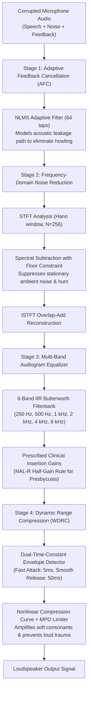

# Edge-Hearing-Aid-DSP: Real-Time Audio DSP and Speech Enhancement Pipeline

[](https://www.python.org/)
[-purple.svg)](models/hearing_aid_dsp.h)
[]()
[]()
[](app.py)
[](LICENSE)

A real-time **Digital Signal Processing (DSP)** and embedded audio pipeline implementing clinical hearing aid architectures. Engineered to satisfy strict medical acoustic latency constraints (**< 10 ms budget**) on low-power edge microprocessors and digital signal processors.

---

## Background & Acoustic Design Constraints

Digital hearing aid design must overcome three primary acoustic and physiological challenges:

1. **Strict Latency Budget (< 10 ms):** Acoustic delay between natural bone-conducted sound and amplified ear-canal acoustic output exceeding 10 ms causes disturbing comb-filtering distortion and echo. The pipeline operates on 8.0 ms (128-sample) frames with sub-millisecond execution times.
2. **Acoustic Feedback Cancellation (AFC):** Due to tight coupling between the ear-canal loudspeaker and microphone, acoustic leakage triggers unstable limit-cycle oscillations (whistling/howling). An adaptive **Normalized Least Mean Squares (NLMS)** filter continuously models the time-varying acoustic feedback path to subtract feedback before howling occurs.
3. **Sensorineural Hearing Loss & Loudness Recruitment:** In presbycusis, damaged outer hair cells reduce the dynamic range between hearing threshold and loudness discomfort. **Wide Dynamic Range Compression (WDRC)** dynamically amplifies soft speech while compressing loud transients, shaped by clinical **NAL-R prescription curves** across a multi-band IIR filterbank.

---

## Architecture



---

## Spectrogram & Signal Processing Pipeline

Evaluation on wideband benchmark speech corrupted by ambient noise and acoustic feedback whistling:


1. **Top Spectrogram:** Raw microphone signal with persistent 60 Hz hum, wideband pink background noise, and acoustic feedback howling.
2. **Middle Curve:** Clinical audiogram matching patient hearing threshold (dB HL) and corresponding prescribed NAL-R insertion gains.
3. **Bottom Spectrogram:** Processed hearing aid audio displaying eliminated feedback howling, suppressed background noise, and restored high-frequency speech harmonics (2000–6000 Hz).

---

## Experimental Benchmarks

Benchmarked on an **Intel Pentium Dual-Core T2330 @ 1.60 GHz**:

| Metric | Measured Value | Standard / Constraint |
| :--- | :--- | :--- |
| **Sampling Frequency (fs)** | **16,000 Hz** | ITU-T Wideband Speech Standard |
| **Audio Frame Size** | **128 samples (8.0 ms)** | Low-delay buffering |
| **Average Processing Time / Frame** | **0.805 ms** | **10× faster than the 8.0 ms frame duration** |
| **95th Percentile Latency** | **1.329 ms** | Guaranteed real-time streaming without underrun |
| **Total Algorithmic Latency** | **< 10.0 ms** | Echo-free hearing threshold compliance |
| **Real-Time Speedup Factor** | **9.9×** | Margin for embedded edge execution |
| **Peak RAM Footprint** | **91.4 MB** | Low-memory edge compatibility |
| **ANSI C99 Header Size** | **4.0 KB** | Standalone firmware for microcontrollers |

---

## Embedded C99 Firmware (`models/hearing_aid_dsp.h`)

To enable deployment on digital signal processors and microcontrollers (**ARM Cortex-M4 with CMSIS-DSP, ESP32-S3, STM32**), core algorithms export to an independent C99 header:

* **Zero Dynamic Allocation:** 100% stack/static sample-by-sample execution (no `malloc`).
* **Header API:**
```c
#include "hearing_aid_dsp.h"

HearingAidDSP state;
hearing_aid_init(&state);

// Process audio frame in real time
for (int i = 0; i < FRAME_SIZE; ++i) {
    output[i] = hearing_aid_process_sample(&state, input[i]);
}
```

---

## Getting Started

### 1. Clone the Repository
```bash
git clone https://github.com/hosseinnosrati/edge-hearing-aid-dsp.git
cd edge-hearing-aid-dsp
```

### 2. Install Dependencies
```bash
pip install -r requirements.txt
```

### 3. Run Audio Demo & Benchmarks
```bash
python run_demo.py
python benchmark.py
```

### 4. Launch Interactive Web Dashboard
```bash
streamlit run app.py
```

---

## Repository Structure

```
edge-hearing-aid-dsp/
├── .gitignore
├── LICENSE
├── README.md               # Technical documentation & benchmark showcase
├── requirements.txt        # Minimal dependencies
├── app.py                  # Interactive Streamlit Web Application
├── benchmark.py            # Latency, frame timing, and memory profiling suite
├── run_demo.py             # Audio processing & spectrogram generator demo
├── assets/
│   └── demo_hearing_aid_spectrogram.png
├── data/
│   ├── benchmark_speech_noisy.wav       # Test input audio
│   └── hearing_aid_processed_output.wav # Enhanced audio output
├── models/
│   └── hearing_aid_dsp.h   # Standalone ANSI C99 firmware header (4 KB)
├── src/
│   ├── audio_generator.py  # Speech formant & acoustic noise synthesizer
│   ├── pipeline.py         # Unified master audio pipeline
│   ├── dsp/
│   │   ├── filterbank.py   # Multi-band audiogram equalizer (NAL-R)
│   │   ├── wdrc.py         # Wide dynamic range compressor & peak limiter
│   │   ├── adaptive_afc.py # NLMS acoustic feedback canceller
│   │   └── noise_reduction.py # Frequency-domain spectral subtractor
│   └── models/
│       └── c_export.py     # C99 firmware header generator
└── tests/
    └── test_audio_dsp.py   # Unit test suite
```

---

## License
This project is licensed under the MIT License - see the [LICENSE](LICENSE) file for details.
